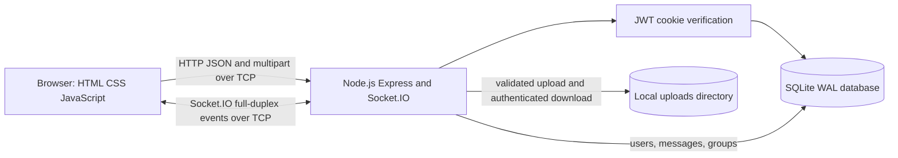

# Real-Time Communication and File Transfer

A Computer Networks mini-project demonstrating a browser-based chat application built with Node.js, Express, Socket.IO, and SQLite. It supports account sessions, one-to-one messages, group rooms, and authenticated file sharing.

## Features

- Account registration and login with bcrypt password hashes.
- JWT session in an HttpOnly, SameSite=Strict cookie; session restoration uses `GET /api/auth/me`.
- Private REST APIs and conversation-participant checks.
- Authenticated Socket.IO handshakes; sender identity comes from the session, not event data.
- Group membership checks for REST history, room joins, and group sends.
- SQLite message persistence, WAL mode, and a five-second busy timeout.
- Multipart file upload with a 10 MB limit, a file-type allowlist, basic content signatures, UUID filenames, and authenticated downloads.
- Safe text rendering, safe attachment links/previews, online indicators, and responsive layout.

## Technology

- Frontend: HTML, CSS, vanilla JavaScript.
- Backend: Node.js and Express.
- Real-time transport: Socket.IO over the same HTTP server.
- Database: SQLite (`database/chat.db`, created at first start).
- Uploads: Multer, stored locally under `uploads/`.
- Authentication: `jsonwebtoken`, `cookie-parser`, and `bcryptjs`.

## Architecture



Express and Socket.IO share the listening port. REST requests use HTTP request/response semantics. Socket.IO provides bidirectional events and can fall back to HTTP long-polling when needed. SQLite stores users and chat history on the server host.

## Project Layout

```text
client/                 Browser UI, styles, and application logic
server/index.js         Express APIs, uploads, and Socket.IO handlers
server/db.js            SQLite connection, schema, and additive migrations
server/middleware/auth.js  JWT verification shared by REST and Socket.IO
server/routes/auth.js   Registration, login, session restore, and logout
database/chat.db        Local runtime database (generated, not committed)
uploads/                Local uploaded files (generated, not committed)
docs/PROJECT_REPORT.md  College project report and viva notes
```

## Setup and Run

Requirements: Node.js and npm. From the project directory:

```powershell
npm install
Copy-Item .env.example .env
node -e "console.log(require('crypto').randomBytes(32).toString('hex'))"
```

Put the generated value in `.env` as `JWT_SECRET=...`. Keep `.env` private; it is ignored by Git. Then start the server:

```powershell
npm start
```

For development with automatic restarts:

```powershell
npm run dev
```

Open `http://localhost:3000`. The first run creates the database and applies additive schema checks. Do not copy a database backup over `database/chat.db` while the server is running.

## API Overview

| Method | Route | Access | Purpose |
| --- | --- | --- | --- |
| `POST` | `/api/auth/register` | Public | Create an account |
| `POST` | `/api/auth/login` | Public | Verify credentials and set session cookie |
| `GET` | `/api/auth/me` | Session | Return the current verified user |
| `POST` | `/api/auth/logout` | Public-safe | Revoke the current token version and clear cookie |
| `GET` | `/api/health` | Public | Basic server health |
| `GET` | `/api/users` | Session | List users for the conversation picker |
| `GET` | `/api/messages/:userId1/:userId2` | Session + participant | Read a conversation involving the current user |
| `POST` | `/api/groups` | Session | Create a group; creator identity comes from the session |
| `GET` | `/api/users/:userId/groups` | Session | List the current user's groups; URL ID is not trusted |
| `GET` | `/api/groups/:groupId/messages` | Group member | Read group history |
| `POST` | `/api/upload` | Session | Upload an allowed file using multipart form data |
| `GET` | `/uploads/:filename` | Session | Download or preview an uploaded file |

Socket.IO event names retained by the application include `register_user`, `send_private_message`, `join_group`, and `send_group_message`. The server ignores client-provided sender IDs. A group room is joined only after checking membership.

## Database

- `users`: account ID, unique username/email, bcrypt hash, `token_version`, and creation time.
- `messages`: sender, receiver, message payload, and creation time.
- `groups`: group name, creator, and creation time.
- `group_members`: group/user membership.
- `group_messages`: group, authenticated sender, message payload, and creation time.

Attachments are stored as files. New attachment message payloads contain a small JSON record in the message field; the optional legacy `file_url` and `file_name` columns remain for compatibility. Existing rows and files are not deleted by startup migrations.

## Network Concepts Demonstrated

- Client-server architecture: browser clients communicate with one Node.js server.
- IPv4/IPv6 addressing and port-based access: the default server port is `3000`.
- HTTP request/response for authentication, REST data, and multipart file transfer.
- TCP-based communication for HTTP and Socket.IO transports.
- Full-duplex real-time communication using Socket.IO events.
- Application-level unicast for one-to-one message delivery.
- Room-based application group broadcast for group chat; this is not IP multicast.
- Database persistence across page reloads and server restarts.
- Connection, reconnection, and disconnect handling, including multiple sockets per user.

This project does not implement a custom TCP protocol, IP multicast, ARP, CRC, routing algorithms, or end-to-end encryption.

## Test and Demonstration

The current `npm test` entry is a placeholder; it does not run an automated suite. Manual integration checks performed during completion are recorded in [the project report](docs/PROJECT_REPORT.md). For a class demonstration, create two accounts in separate browser profiles, send a direct message, create a group, and share an allowed image or document.

### Test on a Local Network

1. Connect the laptop and phone to the same Wi-Fi network.
2. Run `ipconfig` on Windows and note the laptop's IPv4 address.
3. Allow Node.js to accept private-network TCP connections on port `3000` in Windows Firewall.
4. Open `http://<laptop-ipv4>:3000` on the phone (replace the placeholder with the laptop address).
5. Register separate users and test direct chat, group chat, and file sharing.

Use the laptop's LAN address on the phone, not `localhost`. This HTTP development setup is intended for a trusted local network, not public deployment. The phone-to-laptop network test has not been run as part of this workspace session.

## Limitations and Future Scope

- SQLite and uploads are local to one server machine; this is a small single-host project.
- No end-to-end encryption, antivirus scanning, read receipts, or distributed storage.
- Office ZIP-based files receive basic signature checks, not full package inspection.
- Uploaded files require login to fetch, but URLs are not tied to a specific conversation or group membership.
- Local-network testing requires a physical phone and matching network, so follow the manual steps above.

## Viva Questions

1. **Why use HTTP and Socket.IO together?** HTTP handles request/response APIs and file transfers; Socket.IO handles live bidirectional chat events.
2. **Where does a message go?** The browser emits a Socket.IO event to the server, which stores it in SQLite and forwards it to the recipient's active socket(s).
3. **Is one-to-one delivery IP unicast?** It is application-level unicast through a server, not a custom IP-layer protocol.
4. **How does group chat work?** Authenticated members join a Socket.IO room and the server broadcasts group messages to that room.
5. **How are passwords stored?** As bcrypt hashes; the original password is not stored.
6. **How does the app restore login after refresh?** The browser calls `/api/auth/me`; the server verifies its HttpOnly JWT cookie and database token version.
7. **How does logout revoke a session?** The server increments `token_version`, which makes existing JWTs fail verification.
8. **How are uploads transferred?** The browser sends multipart form data over HTTP; Multer validates and stores the file locally.
9. **Why use SQLite WAL?** It helps readers and a writer work concurrently on the local database; a busy timeout allows brief lock waits.
10. **Does the project implement IP multicast or end-to-end encryption?** No. Group messages are server-mediated Socket.IO room broadcasts, and transport/session security is not end-to-end encryption.
