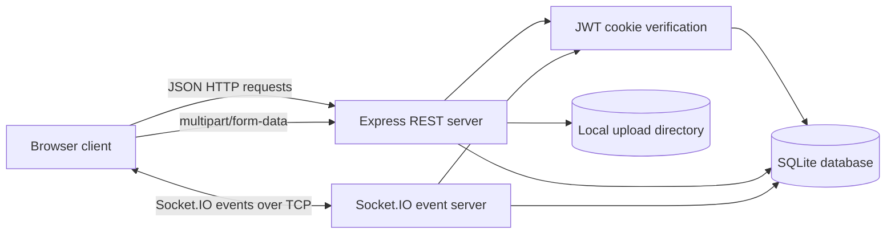

# Project Report

## Real-Time Communication and File Transfer Web Application

**Course:** Computer Networks Mini-Project  
**Implementation:** Node.js, Express, Socket.IO, SQLite, HTML, CSS, and vanilla JavaScript

## Abstract

This project is a browser-based communication application. A Node.js server provides account and REST APIs, maintains a SQLite database, transfers uploaded files over HTTP, and carries live chat events over Socket.IO. The project demonstrates common client-server networking patterns while keeping the implementation small enough to inspect and explain.

## Objectives

- Build a client-server chat application with account login.
- Send one-to-one and group messages in real time.
- Persist users, groups, memberships, and messages in SQLite.
- Transfer supported files using HTTP multipart form data.
- Demonstrate HTTP, TCP, WebSocket-style full-duplex events, and room-based application broadcast.

## System Architecture

The browser and server communicate through the server's listening IP address and port (default `3000`). Express handles request/response APIs and file transfers. Socket.IO carries bidirectional events on the same server and can use WebSocket or HTTP long-polling transport. SQLite and the upload directory are local to the server machine.

## Working

### Authentication

Registration stores a bcrypt password hash. Login signs a 24-hour HS256 JWT and sets it in an HttpOnly, SameSite=Strict cookie. REST middleware and Socket.IO handshake middleware call the same JWT verification helper and compare the token's `tokenVersion` with the user's database value. Logout increments that value and clears the cookie. The browser restores a session by calling `GET /api/auth/me`; localStorage is not used as proof of identity.

### One-to-One Messaging

The client emits `send_private_message` with a recipient and message. The server verifies the connection session, ignores the supplied sender ID, persists the message, and emits it to the recipient's active socket connections. The server sends a confirmation to the sender. The conversation-history API requires the authenticated user's ID to be one of the two participants.

### Group Messaging

A group creator is taken from the verified session. Selected existing users are inserted into the membership table. REST group history and Socket.IO room joins/sends verify membership. Each user's active browser sockets are kept in a set, so disconnecting one tab does not mark the account offline while another tab remains connected.

### File Transfer

The browser sends a multipart request to `/api/upload`. Multer applies a 10 MB limit, an extension/MIME allowlist, and randomized UUID-based storage names. The server checks common file signatures and rejects unsupported extensions, HTML/SVG, and mismatched binary content. Downloads require a valid session and return `X-Content-Type-Options: nosniff`. Raster images can be previewed; attachment names and URLs are rendered as text and validated same-origin upload links.

## Database Structure

| Table | Purpose |
| --- | --- |
| `users` | Usernames, email addresses, bcrypt hashes, token versions, creation time |
| `messages` | Direct messages with sender, receiver, payload, and timestamp |
| `groups` | Group name and creator |
| `group_members` | Users allowed in each group |
| `group_messages` | Group messages with sender and timestamp |

SQLite WAL mode and a five-second busy timeout are enabled. Startup schema checks add missing optional columns without replacing the existing database. Attachments are stored in the upload directory; new message payloads reference them using a structured JSON prefix. Existing optional file metadata columns remain in the schema.

## API Summary

| Route | Authorization |
| --- | --- |
| `POST /api/auth/register` | Public |
| `POST /api/auth/login` | Public |
| `GET /api/auth/me` | Valid session |
| `POST /api/auth/logout` | Public-safe; revokes a valid cookie session |
| `GET /api/health` | Public |
| `GET /api/users` | Valid session |
| `GET /api/messages/:userId1/:userId2` | Valid session and participant |
| `POST /api/groups` | Valid session; creator comes from session |
| `GET /api/users/:userId/groups` | Valid session; URL user ID is ignored for identity |
| `GET /api/groups/:groupId/messages` | Valid session and group membership |
| `POST /api/upload` | Valid session |
| `GET /uploads/:filename` | Valid session |

Socket events include `register_user`, `send_private_message`, `join_group`, and `send_group_message`. `register_user` remains for client compatibility, but its user ID is ignored.

## Computer Networks Concepts

- **Client-server architecture:** browser clients request services from a central server.
- **IP address and port:** clients connect to the server host and TCP port `3000` by default.
- **HTTP:** login, REST data, and file transfer use HTTP requests and responses.
- **TCP:** HTTP and Socket.IO transports use TCP connections.
- **Full-duplex communication:** Socket.IO events allow both sides to send messages during an active connection.
- **Application-level unicast:** a direct message is routed to a particular user's connected sockets by the server.
- **Room-based group communication:** a server broadcasts to a Socket.IO room after membership verification. This is not IP multicast.
- **Multipart file transfer:** files are submitted in an HTTP `multipart/form-data` request.
- **Persistence and connection state:** SQLite preserves data; Socket.IO connect/disconnect events update online presence.

The project does not implement a custom TCP protocol, IP multicast, ARP, CRC, routing algorithms, or end-to-end encryption.

## Setup and Demonstration

1. Install Node.js and npm.
2. Run `npm install` in the project directory.
3. Copy `.env.example` to `.env` and set `JWT_SECRET` to a random value of at least 32 characters. Generate one with `node -e "console.log(require('crypto').randomBytes(32).toString('hex'))"`.
4. Run `npm start` or `npm run dev`.
5. Open `http://localhost:3000`, register two accounts, and test direct chat, group chat, and file sharing.

For laptop-to-phone testing, connect both devices to the same Wi-Fi, find the laptop IPv4 address with `ipconfig`, permit Node.js on TCP port `3000` in Windows Firewall, and open `http://<laptop-ipv4>:3000` on the phone. This physical-device test was not performed in the development workspace.

## Verification Record

The following checks were executed during implementation:

- Browser registration, login, and authenticated session restoration after reload.
- Public health endpoint and anonymous rejection of private REST routes.
- Conversation participant denial and user-specific group list behavior.
- Socket.IO cookie authentication, sender-ID spoof resistance, and multi-socket online-state snapshot.
- Group creation with a forged creator ID, non-member REST history denial, and non-member socket join/send denial.
- Supported PNG upload, rendered image preview, authenticated download, and anonymous download rejection.
- HTML, executable extension, disguised PNG, HTML-as-text, and over-limit upload rejection; ordinary short text acceptance.
- Direct message delivery between two isolated browser sessions, history after reload and server restart, group history after restart, and authenticated attachment download after restart.
- Responsive layout check at 390x844 and 1366x900; the document did not overflow horizontally.
- JavaScript parser checks and editor diagnostics for changed application files.
- SQLite reported `wal` journal mode.

A formal automated test suite is not configured; `npm test` remains a placeholder. Real laptop-to-phone operation still requires a phone and the same Wi-Fi network, so it remains a presentation-time/manual check. The browser-to-browser message and database-persistence checks above were performed with separate browser sessions on this machine.

## Limitations and Future Scope

- SQLite and files are stored on one host; this is not a distributed deployment.
- Uploaded-file URLs require login, but file access is not scoped to the originating conversation or group.
- File checks are a small allowlist and signature check, not antivirus scanning or complete Office package inspection.
- No end-to-end encryption, read receipts, typing state, or user-managed group membership screen.
- Production deployment should use HTTPS, a protected secret manager, backups, and operational monitoring.

## Viva Questions and Answers

1. **Why are both HTTP and Socket.IO used?** HTTP suits request/response APIs and multipart uploads; Socket.IO suits live bidirectional events.
2. **How is a login session checked?** The server verifies an HS256 JWT cookie and checks its token version against SQLite.
3. **How is a sender ID protected?** The server derives it from the verified socket session and ignores the event's claimed sender ID.
4. **How is group access controlled?** The server checks the `group_members` table before history reads, room joins, and sends.
5. **How does a direct message reach a user with two tabs?** The server stores all active socket IDs for the account and emits to that set.
6. **What does WAL provide?** It improves local reader/writer concurrency; the busy timeout allows short lock waits.
7. **Is group chat IP multicast?** No. It is an application-level broadcast through a Socket.IO room on the server.
8. **Does the app provide end-to-end encryption?** No. Authentication cookies protect sessions, but the server handles message content.
